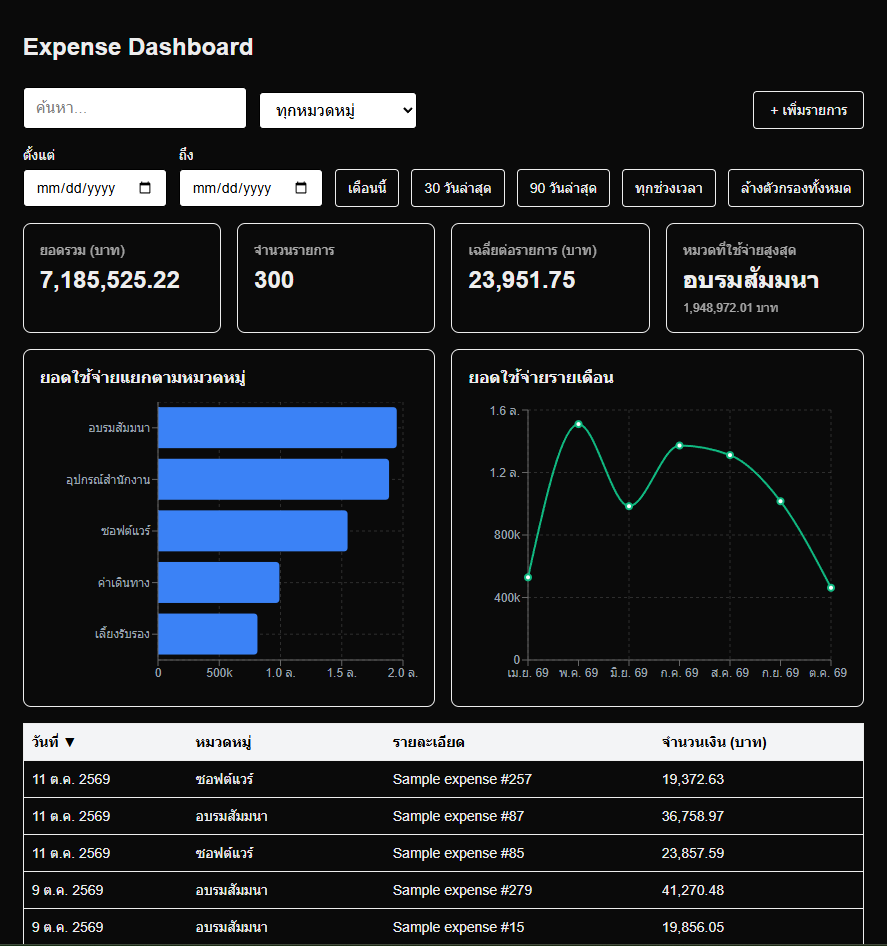
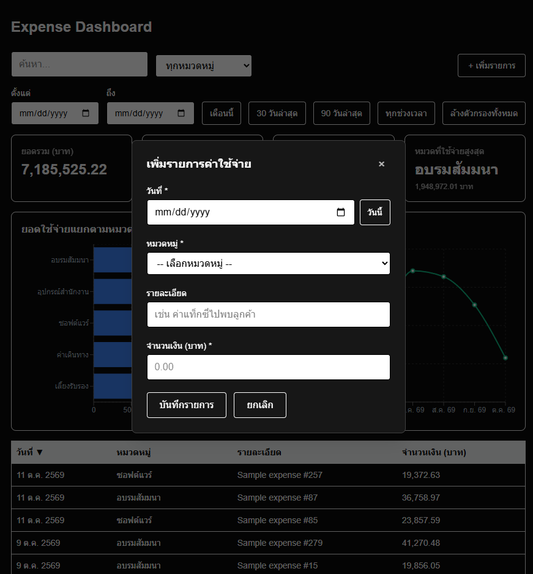

# Expense Dashboard

เว็บบันทึกและวิเคราะห์ค่าใช้จ่ายของบริษัท: เพิ่มรายการ ดูสรุปยอด และกรอง/เรียง/ค้นหาข้อมูลได้

🔗 **เว็บเดโม:** https://skill-test-for-programmer-trainee-p-olive.vercel.app/

> ข้อมูลทั้งหมดเป็นข้อมูลสมมติ และเว็บเดโมเปิดให้เพิ่มรายการได้โดยไม่ต้องล็อกอิน




## ฟีเจอร์

- ป็อบอัพเพิ่มรายการค่าใช้จ่าย (วันที่ หมวดหมู่ รายละเอียด จำนวนเงิน) ตรวจสอบข้อมูลทั้งฝั่งเว็บ เซิร์ฟเวอร์ และฐานข้อมูล
- การ์ดสรุป: ยอดรวม จำนวนรายการ ค่าเฉลี่ย หมวดที่ใช้จ่ายสูงสุด
- กราฟยอดใช้จ่ายแยกตามหมวดหมู่ และรายเดือน
- ตารางที่เรียงลำดับ ค้นหา และแบ่งหน้าได้
- กรองตามหมวดหมู่และช่วงวันที่ (ปุ่มลัด เดือนนี้ / 30 วัน / 90 วัน) โดยการ์ดและกราฟเปลี่ยนตามตัวกรอง

## เทคโนโลยีที่ใช้

Next.js (App Router) · TypeScript · Tailwind CSS · Supabase (PostgreSQL) · TanStack Table · Recharts · Vercel

## โครงสร้างฐานข้อมูล

ดู [`supabase/schema.sql`](supabase/schema.sql) มี 2 ตาราง คือ `categories` และ `expenses` (อ้างอิงกันด้วย foreign key)
ใช้ Row Level Security: อ่านและเพิ่มข้อมูลได้ แก้ไข/ลบไม่ได้

## รันบนเครื่องตัวเอง

```bash
git clone https://github.com/pantavesamran-blip/Skill-Test-for-Programmer-Trainee_Pantave-Samran.git
cd Skill-Test-for-Programmer-Trainee_Pantave-Samran
npm install
```

สร้างไฟล์ `.env.local`

```
NEXT_PUBLIC_SUPABASE_URL=https://lnzbpukpcyhkvsyjskik.supabase.co
NEXT_PUBLIC_SUPABASE_PUBLISHABLE_KEY=sb_publishable_KDm86SwLXbuCbyzcFiMHEQ_gV_mHbvn
```

สร้างโปรเจกต์บน Supabase แล้วรัน SQL ใน `supabase/schema.sql` จากนั้น

```bash
npm run dev
```

เปิด http://localhost:3000

## สิ่งที่อยากพัฒนาต่อ

- ระบบล็อกอิน (Supabase Auth) จำกัดสิทธิ์เพิ่มข้อมูลเฉพาะคนในบริษัท
- แก้ไข/ลบรายการ
- กรองและแบ่งหน้าฝั่งฐานข้อมูลเมื่อข้อมูลมีจำนวนมาก

---

จัดทำโดย นางสาว ปัณฑาวีย์ สำราญ